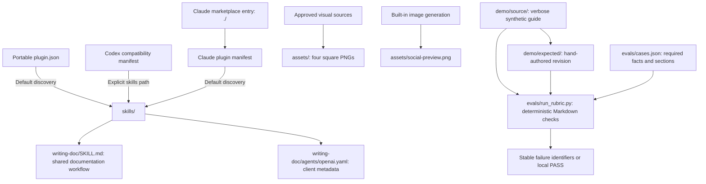
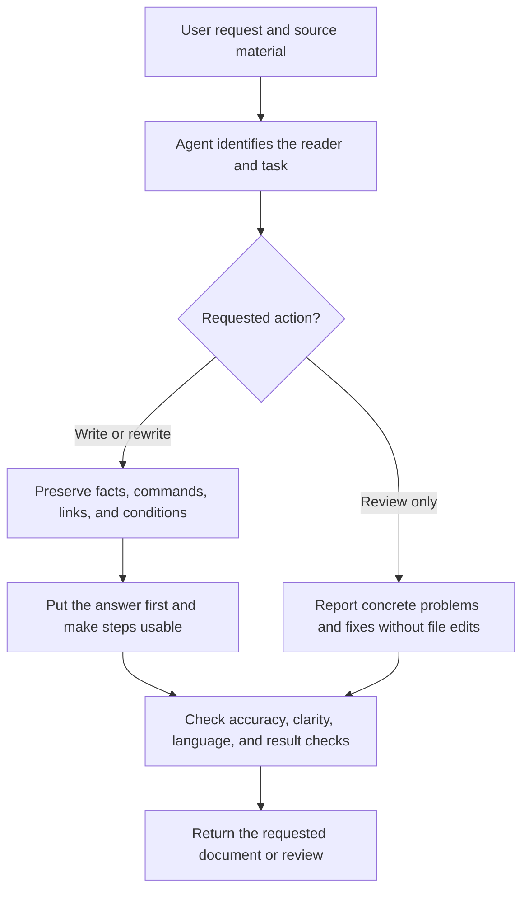
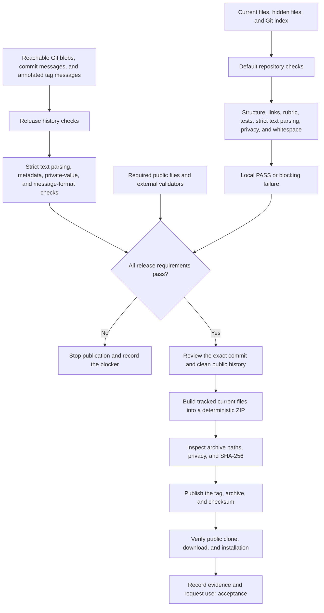
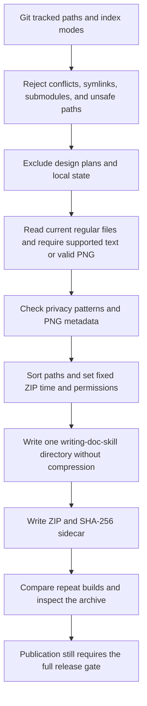

# How Writing Doc Works

`writing-doc` guides an agent to turn verbose AI output into technical documentation that a target reader can understand and use.

The skill is an editor's desk: it keeps the source facts but rearranges them so the intended reader can find and use them.

The package contains instructions for the user's agent, not a separate document service.
This repository defines the package identity for release `0.1.0`.
The package uses the MIT license.
Its configured repository URL is `https://github.com/joevilcai666/writing-doc-skill`.
The configured URL does not establish public availability.

## Find the part you need

- [Package structure](#package-structure) explains which files supply the product.
- [Documentation workflow](#documentation-workflow-and-visuals) explains what the agent receives.
- [Evidence and limits](#evidence-and-limits) separates implementation from real use.
- [Synthetic demonstration](#synthetic-demonstration-and-local-rubric) explains what the local example proves.
- [Local gates](#local-repository-and-privacy-gates) explains the publication checks and current blockers.
- [Release archive](#deterministic-release-archive) explains the ZIP and checksum builder.

## Package structure

A manifest is a package label. It tells a client which package it reads.
The three plugin manifests identify the same package.
They use one shared skill directory.

The portable manifest declares the Agent Plugins 1.0.0 schema.
The Codex compatibility manifest points to `./skills/`.
Claude Code uses its default `skills/` location.
The Claude marketplace exposes one local plugin from the repository root.

| Module | Responsibility |
| --- | --- |
| `skills/writing-doc/SKILL.md` | Gives every client the same reader-focused writing instructions. |
| `plugin.json`, `.codex-plugin/`, `.claude-plugin/` | Label the package and let clients discover the shared skill. |
| `agents/openai.yaml` | Supplies the skill label, default prompt, and invocation policy for OpenAI clients. |
| `assets/` | Supplies the approved problem and solution artwork and the social preview. |
| `demo/` and `evals/` | Show one synthetic revision and check fixed document conditions. |
| `scripts/` and `tests/` | Check package structure, privacy patterns, and local behavior. |
| `scripts/build_release.py` | Builds the ZIP from tracked current files and supplies its SHA-256 checksum. |
| READMEs and `docs/distribution.md` | Explain use, planned installation routes, and observed distribution status. |

The `agents/openai.yaml` file supplies the skill name and default prompt for OpenAI clients.
Its invocation policy permits implicit invocation.
This policy permits automatic skill selection when a client supports it.
It does not prove that a client loaded or invoked the skill.

## Documentation workflow and visuals

The shared `skills/writing-doc/SKILL.md` contains the authoritative Chinese instructions.
It identifies the reader and task, puts answers first, and preserves technical facts.
It keeps the user's language and checks whether the reader can complete the task.
For review-only requests, it reports concrete problems and fixes without file edits.
It excludes marketing copy, literary text, and file conversion without a documentation task.

A skill is an instruction sheet for an agent.
The client reads that sheet when it selects the skill.
The package does not prove that the agent follows the instructions in a real session.
The client controls model choice, tools, file access, and any network request.

The skill adds no agent loop, memory store, subagent system, server, background process, analytics, or telemetry.
It does not modify `AGENTS.md`, `CLAUDE.md`, or global agent instructions.
Installation tools can update their own client settings and skill directories.

The `assets/` directory contains four approved 1200 × 1200 PNG images.
The files cover problem and solution messages in English and Chinese.
Their image data matches the approved source files.
The package removes private metadata chunks without a change to the image data or dimensions.
The separate 1280 × 640 social preview uses the same visual direction.
The built-in image generator produced the preview, and a proportional resize set its final dimensions.

## Evidence and limits

| Evidence level | Meaning | Current state |
| --- | --- | --- |
| Implemented | The files or behavior exist in the repository. | Version, license, manifests, skill metadata, shared skill, five PNG assets, synthetic rubric, local gates, public docs, deterministic archive builder, release note, and verification template exist. |
| Locally verified | A local check passed on an identified source state. | The local source state passed 125 tests with Python 3.9.6 on macOS arm64. Nineteen tests cover archive behavior. The default repository checker, skill validator, and Claude strict validator passed. Codex validation reported `SKIP`. The release gate remains blocked. |
| Publicly verified | A check passed against a public clone, download, or installation. | No public clone, installation, or runtime check completed. Remote install commands remain planned. |
| User accepted | The user explicitly accepted the result under review. | The user approved the four source images. No user acceptance evidence exists for this package implementation or actual reader outcomes. |

The local checks cover package metadata, required skill boundaries, PNG dimensions, and source-copy integrity.
They do not establish client installation, agent behavior, or public availability.
Visual inspection covers the preview text, composition, and legibility.
No public clone, release, or package acceptance check completed.
The READMEs label every remote installation route `Planned for v0.1.0 verification`.
The [distribution record](docs/distribution.md) contains channel status, not an endorsement claim.

## Synthetic demonstration and local rubric

The demonstration uses a fictional local service, Lantern API.
Its source guide mixes background, setup, and failures in long paragraphs.
Its revised guide puts the command first and supplies prerequisites, three steps, a result check, and one failure entry.
Both guides contain the six exact technical literals from the case definition.
No service or real token accompanies this example.

The rubric is a checklist for document structure, like a preflight check for a document.
It checks literal preservation, command placement, section presence, a health response check, and paragraph length.
The evaluator returns stable rule identifiers. Its CLI returns 0 for a pass and 1 for rule failures.
It accepts different prose and heading case. It does not compare a document with the expected guide word for word.

Fifteen rubric tests passed locally with Python 3.9.6 on macOS arm64.
The expected guide passed the local CLI check.
The source failed the checks for answer order, required sections, verification, and paragraph length.
The full local suite includes these checks and the repository gate tests.

These results cover static synthetic documents and deterministic checks.
They do not prove that an agent follows the skill, that a service runs, or that a real reader understands the result.
Language retention, review-only behavior, scope selection, client installation, and public availability still need separate evidence.

## Local repository and privacy gates

A release gate is a checklist that stops publication when a required check fails.
`python3 scripts/check_repo.py` checks the current package files and Git index.
It checks package versions, JSON syntax, skill frontmatter, local Markdown links, PNG files, and README image references when a README exists.
It also runs the rubric, the unit suite, privacy checks, and Git whitespace checks for both the worktree and index.
The unit gate rejects an empty test suite.

The privacy scanner reads tracked files and non-ignored untracked files. This includes hidden files.
It also reads staged blobs, so a safe worktree cannot conceal a private staged value.
`python3 scripts/privacy_scan.py --history` adds every reachable Git blob from every local ref.
It also checks every reachable commit message and annotated tag message. This includes nested tags.

Those checks include deleted files and PNG metadata in historical blobs.
Git identity headers remain outside the private-value scan.
It rejects shallow history, replacement refs, read failures, malformed PNG chunks, and unsafe file links.

The scanner checks home paths, common credential forms, email addresses, signed URLs, and private-key headers.
Credential assignments include quoted JSON and JSON-like field names.
They also include supported command arguments with one or two leading hyphens.
It rejects PNG `tEXt`, `zTXt`, `iTXt`, and `eXIf` chunks.

For other file content, the scanner accepts strict UTF-8, with or without a byte-order mark (BOM).
A BOM is an encoding label at the start of a file, like a label on a container.
UTF-16LE, UTF-16BE, UTF-32LE, and UTF-32BE require that label.
The scanner rejects invalid text and decoded NUL, C0, DEL, and C1 control characters, except tab, carriage return, and newline.
It does not guess an encoding or replace invalid bytes.
Unknown content blocks current, index, history, and archive checks with `text-invalid` at the fixed location `[file-content]`.

Each finding reports a rule and location with a fixed redaction marker.
It never includes a matched value or source excerpt.
It redacts a full path when the path contains a private value.
An invalid-content finding includes no original filename or decoder error.
The repository checker also suppresses external tool output.

The message parser separates Git object headers from the message body before any private-value check.
It checks UTF-8 messages and supports a fixed set of declared commit-message encodings.
Missing message boundaries, unsupported or duplicate encoding headers, invalid text, and binary control bytes block the history check.
Message findings use fixed location labels and verified Git object identifiers.
They never include author identity, tag names, or message excerpts.

`python3 scripts/check_repo.py --release` requires all final public files and the external validators.
Default mode reports an unavailable validator as `SKIP`.
Release mode treats the same missing validator as a failure.
Validator command overrides use JSON argument arrays in `WRITING_DOC_SKILL_VALIDATOR`, `WRITING_DOC_CODEX_VALIDATOR`, and `WRITING_DOC_CLAUDE_VALIDATOR`.
Commands support `{root}` and `{skill}` path placeholders and do not use a shell.

The current five PNGs pass the metadata scan.
Each file lost only its 68-byte `eXIf` payload and 12-byte chunk envelope.
All safe chunks remain byte-for-byte identical. These include `IHDR`, `IDAT`, and `IEND`.
The current Claude marketplace supplies the description that its strict validator requires.

The private development history still contains five earlier PNG blobs with `eXIf` metadata.
The full history scan therefore fails, as required.
The release process must create a clean reviewed public history and rerun both release checks before any public push.
The installed Codex CLI has no plugin validation command, so its required external validator remains unavailable.

The public README files exist.
The local candidate archive and checksum exist. Public installation evidence remains incomplete.
The release flow in the diagram describes the gate's required sequence, not completed publication.

No GitHub Actions status or billing check serves as the release gate.
Local evidence must identify the exact commit, commands, environment, and results before publication.

These checks detect fixed patterns and structural defects.
They do not prove that all private information is absent.
Ignored untracked files, Git author metadata, unreachable Git objects, and compressed archive contents need separate review when relevant.
No public release or package acceptance check completed.

## Deterministic release archive

A checksum is a file's fingerprint. The same bytes produce the same SHA-256 value.
It checks file identity, not publisher identity or the absence of private data.

`python3 scripts/build_release.py --output dist` builds a local release candidate.
The API is `build_release(root: Path, output_dir: Path) -> tuple[Path, str]`.
It returns the archive path and its SHA-256 value.
For version `0.1.0`, the outputs are `writing-doc-skill-v0.1.0.zip` and its `.zip.sha256` sidecar.
The builder does not authorize publication or bypass the release gate.

The builder reads current contents only for paths from `git ls-files -z`.
The index supplies each file's executable flag. Local timestamps and permissions do not affect archive bytes.
New files enter the archive after `git add`. A modified tracked file enters with its current content.
Release evidence must therefore identify a clean exact commit before publication.

The archive excludes `docs/superpowers/`, `evals/runs/`, `dist/`, and local SDD, validator, worktree, cache, and dependency directories.
The builder rejects unsafe names, case collisions, unreadable files, malformed Git inventories, unresolved index conflicts, symlinks, and submodules.
It opens each source directory without symlink traversal, so a concurrent parent symlink swap cannot redirect a read outside the source tree.
It checks text privacy patterns and PNG metadata before output creation.
It uses the same strict text parser as the repository privacy scanner.
Unsupported encoding, invalid bytes, and forbidden control characters block output creation.
It copies safe PNG bytes without a change.
It reports fixed error text without private values, paths, or Git diagnostics.

Every entry uses `1980-01-01 00:00:00` and Unix permissions `0644` or `0755`.
Names use UTF-8, and every file sits under `writing-doc-skill/`.
The ZIP uses no compression, which avoids compression-library differences between build hosts.
The checksum sidecar names only the ZIP filename. Run `shasum -a 256 -c writing-doc-skill-v0.1.0.zip.sha256` from `dist/`.

Local archive tests cover repeated bytes, exact file sets, Unicode names, permission normalization, checksum contents, CLI exits, and failure paths.
They also cover private text, PNG metadata, source symlinks, destination symlinks, submodules, missing files, and Git errors.
Encoding checks cover all four BOM-less UTF-16 and UTF-32 forms across current files, index blobs, reachable history, deleted history, and archives.
Safe ASCII, UTF-8, text with a BOM, and PNG data retain their accepted behavior.
Archive checks do not inspect Git history or prove client installation.
The [release note](docs/releases/v0.1.0.md) describes the candidate.
The [verification template](docs/verification/v0.1.0.md) leaves every result pending for the exact public candidate.

最后更新时间：2026-10-15 20:45（Asia/Shanghai）
