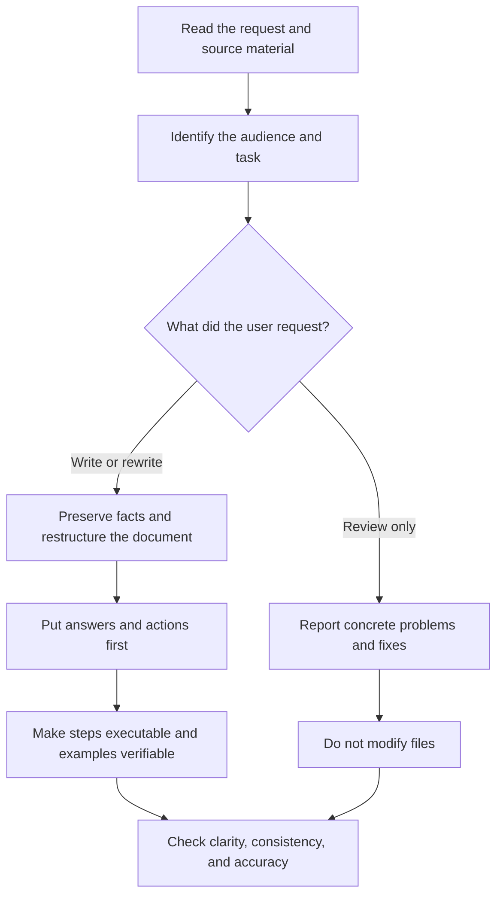
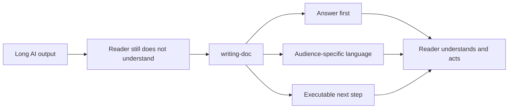

# Writing Doc Skill — Public Repository Design

Date: 2026-10-15
Status: Approved design

## Purpose

`writing-doc` turns verbose or unclear AI output into technical documentation that a specific audience can understand and use.

The public repository will let people install the same skill in Codex, Claude Code, and clients that support the Agent Skills format. The repository will publish only synthetic examples and public project material.

## User problem

AI can produce a large amount of grammatically correct text without completing the communication task. Readers can finish a document and still miss the answer, misunderstand the subject, or not know what to do next.

The repository will express this problem with the following product message:

> AI wrote a lot. Your reader still does not get it.

The Chinese version will use:

> AI 写了一大篇，读完还是不懂。

## Product promise

`writing-doc` helps an agent:

- identify the target audience and the task that the document must support;
- put the answer or required action first;
- remove repetition, filler, and vague transitions;
- preserve technical facts, commands, links, and necessary conditions;
- explain required terms in language the audience can understand;
- make procedures executable and results verifiable;
- keep the user's language and follow the requested scope;
- review without editing when the user asks only for a review.

The skill does not handle marketing copy, literary writing, or file-format conversion that has no documentation-writing task.

## Repository structure

The repository will keep one shared `writing-doc` skill. Client manifests will point to the same source.

```text
writing-doc-skill/
├── README.md
├── README.zh-CN.md
├── HOW_IT_WORKS.md
├── LICENSE
├── SECURITY.md
├── CONTRIBUTING.md
├── CHANGELOG.md
├── VERSION
├── plugin.json
├── .codex-plugin/plugin.json
├── .claude-plugin/
│   ├── plugin.json
│   └── marketplace.json
├── skills/writing-doc/
│   ├── SKILL.md
│   └── agents/openai.yaml
├── demo/
├── evals/
├── scripts/
├── tests/
├── docs/
└── assets/
```

The repository will not include a setup skill because `writing-doc` does not need to modify a user's `AGENTS.md` or `CLAUDE.md`.

## Skill workflow

The installed skill will guide an agent through this decision flow:



The skill will retain the existing `writing-doc` guidance as the source of truth. Packaging work can improve metadata and supporting examples, but it will not broaden the skill into unrelated writing tasks.

## README message and sequence

The English README will open with:

> **AI wrote a lot. Your reader still does not get it.**  
> writing-doc turns AI output into clear, useful documentation your audience can understand and act on.

The Chinese README will open with:

> **AI 写了一大篇，读完还是不懂。**  
> writing-doc 把 AI 输出变成目标读者看得懂、用得上、能照着行动的文档。

Each README will use this sequence:

1. State the reader problem.
2. Show the approved problem image.
3. State the product promise.
4. Show the approved solution image.
5. Provide the shortest verified installation path.
6. Show a synthetic before-and-after example.
7. Explain supported tasks, boundaries, privacy, and verification status.
8. Link to other installation methods, contribution guidance, security policy, and release evidence.

## Visual assets

The repository will include four approved 1200 × 1200 PNG files for X and README use:

- Chinese problem image;
- Chinese solution image;
- English problem image;
- English solution image.

The images use the same visual system and keep each language separate. The repository will also provide a 1280 × 640 GitHub social preview that uses the same brand direction but contains less detail.

The image set communicates one transformation:



## Demonstration and evaluation

The repository will use a fully synthetic technical-documentation example. The example will compare a verbose AI-generated guide with a revised guide for a named target audience.

Behavioral evaluation will check that the skill:

- keeps Chinese requests in Chinese and English requests in English;
- distinguishes review-only requests from editing requests;
- preserves commands, parameters, links, facts, units, and necessary conditions;
- puts the answer or action before background detail;
- includes prerequisites, expected results, and verification when the task needs them;
- does not activate for clearly unrelated marketing or literary-writing tasks;
- does not expose private source material in public examples.

Tests will focus on observable outcomes and meaningful invariants. They will not require exact generated wording.

## Privacy and safety

The public repository will start from a new Git history. It will not copy private repository history, real user documents, private URLs, local user paths, credentials, chat content, or personal data.

Before the first public push, the release process will scan:

- tracked files;
- Git history;
- image metadata;
- hidden files and manifests;
- release archives.

The repository will not add analytics or telemetry. The README will state that the skill can read material provided to the agent but does not upload documents by itself.

## Packaging and installation

The repository will support:

- Codex plugin installation;
- Claude Code plugin installation;
- installation with the `skills` command-line tool;
- manual installation of `skills/writing-doc` as a fallback.

The implementation will verify current official manifest and installation requirements before publication. Documentation will separate current-version commands from pinned-version commands.

## Release and distribution

The first public release will use:

- repository: `joevilcai666/writing-doc-skill`;
- default branch: `main`;
- version: `v0.1.0`;
- an annotated Git tag;
- a deterministic release ZIP;
- a published SHA-256 checksum;
- GitHub topics and a social preview.

The release process will complete local review and privacy checks before it creates or pushes the public repository. It will push the reviewed commit explicitly to `main`.

The project will inspect natural skills.sh discovery after publication. It will not describe a listing as officially reviewed unless the directory provides that evidence. Submission to other directories will record the real state when login, manual confirmation, or external review is required.

## Verification and evidence

Local verification is the release gate. GitHub Actions status is not a release requirement.

The verification record will include:

- the exact commit;
- the commands that ran;
- the local environment;
- skill and manifest validation results;
- repository tests and privacy-scan results;
- public clone and installation results;
- release-archive checksum results;
- remaining manual or external checks.

The documentation will distinguish four evidence levels:

| Evidence level | Meaning |
|---|---|
| Implemented | The repository contains the code or document. |
| Locally verified | A local check passed on the stated commit. |
| Publicly verified | A public clone, download, or installation passed. |
| User accepted | The user explicitly accepted the result. |

`HOW_IT_WORKS.md` will describe the current behavior, architecture, maintenance flow, verified evidence, and known limits. It will not serve as a change log.

## Completion criteria

The first release is complete when:

1. the shared skill and client manifests pass their available validators;
2. the English and Chinese READMEs use the approved product message and images;
3. the synthetic demonstration and behavioral evaluation pass;
4. the repository and Git history pass the privacy checks;
5. the public repository, `v0.1.0` tag, Release ZIP, and checksum exist;
6. public installation paths that can run without manual identity confirmation pass in clean temporary directories;
7. `HOW_IT_WORKS.md` and the release verification record match the observed evidence;
8. external steps that require user identity, review, or confirmation remain explicitly marked as pending.
